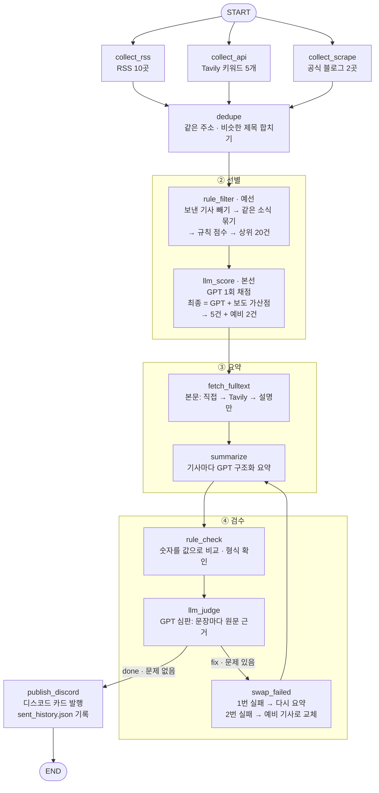
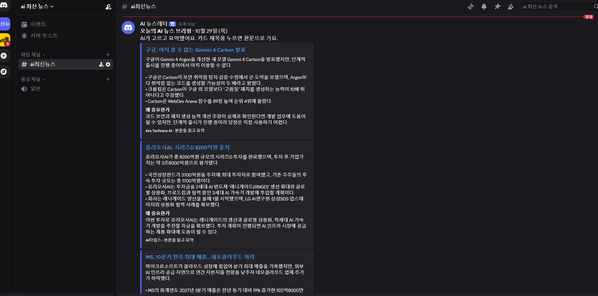

# AI 뉴스레터 에이전트 — 프로젝트 보고서

매일 아침 AI 업계 소식 100여 건을 모아 **중요한 5건을 골라 한국어로 요약하고, 원문과 맞는지 검수한 뒤 디스코드로 발행**하는 LangGraph 에이전트입니다.

| 항목 | 내용 |
|---|---|
| 실행 | `python run.py` (윈도우: `실행하기.bat` 더블클릭 → 설치부터 발행까지) |
| 구성 | 노드 12개 + 조건부 분기 1개 (`graph.py`) |
| 사용 모델 | OpenAI `gpt-6-luna` (못 쓰면 `gpt-6.1-terra` → `gpt-5-mini` → `gpt-4.1-mini` 순서로 자동 대체) |
| 외부 서비스 | RSS 10곳 · Tavily(뉴스 검색 · 본문 추출) · 스크래핑 2곳 · 디스코드 웹훅 |
| 실행 기록 | `store/metrics.jsonl` (실행마다 한 줄), `store/last_run.json` (마지막 실행 자세히) |

```
my-newsletter/
├── graph.py              # LangGraph 워크플로우 (노드 연결 · 조건부 분기)
├── run.py                # 파이프라인 실행 + store/metrics.jsonl 기록
├── audience.yaml         # 타깃 독자 · 중요도 기준 · 제외 조건
├── config.py             # 소스 목록 · 기술 설정 (audience.yaml을 불러옴)
├── state.py              # 노드들이 주고받는 State 정의
├── llm.py                # GPT 구조화 출력 호출 (모델 자동 대체)
├── utils.py              # 웹 요청 · 날짜 읽기 · 주소 정리 · 본문 추출
├── nodes/                # 단계별 노드
│   ├── collect.py        #   ① 수집: collect_rss / collect_api / collect_scrape / dedupe
│   ├── select_news.py    #   ② 선별: rule_filter(예선) / llm_score(본선)
│   ├── summarize_news.py #   ③ 요약: fetch_fulltext / summarize
│   ├── review_news.py    #   ④ 검수: rule_check / llm_judge / route / swap_failed
│   └── publish_news.py   #   ⑤ 발행: publish_discord
├── stages/               # 단계 하나씩 따로 실행해 보는 스크립트 (run_collect.py ~ run_publish.py)
├── store/
│   ├── metrics.jsonl     # 실행 및 검수 기록
│   ├── last_run.json     # 마지막 실행 결과
│   └── sent_history.json # 보낸 기사 기록 (같은 기사 재발송 방지)
├── docs/discord_result.png  # 발행 결과 화면
├── 실행하기.bat · start.py · check_env.py · test_discord.py   # 윈도우 원클릭 실행 도우미
├── requirements.txt · .env.example · .gitignore
└── REPORT.md
```

---

## 1. 분야 및 독자 정의

### 분야: AI 업계 뉴스 (모델 · 도구 · 기업 동향 · 정책)

AI 업계에서는 매일 새 모델과 도구, 정책 소식이 쏟아집니다. 최신 동향을 챙기는 일은 중요하지만, 여러 매체를 돌며 기사를 읽고 그중 **내 일에 영향을 줄 소식만** 골라내려면 아침마다 적지 않은 시간이 듭니다. 실제로 이 에이전트가 하루에 모으는 기사는 **102~113건**(5회 실행 기준)인데, 이 중 독자에게 꼭 필요한 것은 몇 건뿐입니다. 이 "고르고, 읽고, 확인하는" 일을 에이전트에게 맡기는 것이 목표입니다.

### 타깃 독자 페르소나 (`audience.yaml`)

| 항목 | 내용 |
|---|---|
| 누구 | 개발자는 아니지만 생성형 AI 도구와 에이전트를 업무에 써 보려는 **한국 직장인** |
| 언제 · 어디서 | 출근 전후 5분, 휴대폰의 디스코드 알림으로 |
| 원하는 것 | 내 업무에 쓸 수 있는 새 모델 · 도구 · 기능 / 빅테크 · 국내 AI 기업의 큰 움직임(실적 · 투자 · 인수) / AI 규제 · 정책 변화 |
| 원하지 않는 것 | 광고성 글, 근거 없는 소문 / 학술적 세부 / 영어 원문을 끝까지 읽어야 이해되는 요약 |

이 페르소나가 설계에 준 영향:
- **5건만, 한국어로**: 5분 안에 읽을 분량. 영어 기사도 한국어로 요약하되, 제품 · 모델 이름은 원문 표기(예: Gemini 4 Carbon)를 그대로 둡니다.
- **"왜 중요한가" 칸**: 기사 내용만이 아니라 독자 업무와의 관계를 한 문장으로 붙입니다.
- **틀린 요약은 안 보내는 것이 우선**: 사람이 확인하지 않고 매일 자동 발송하므로, 검수에서 통과 못 한 기사는 빼고 예비 기사로 바꿉니다.
- 프롬프트에는 `reader: "AI 도구와 에이전트를 업무에 활용하려는 한국 직장인"`이 그대로 들어갑니다.

---

## 2. 소스 채택표

### 측정 방법
- 2026-10-29 하루 동안 **실제 실행 5회**(A~E)의 화면 기록과 결과 파일로 측정했습니다 (`store/metrics.jsonl`).
- **24시간 기사 수**: 실행 시점 기준 최근 24시간 안에 발행된 기사 수 (5회 값).
- **접속 성공**: 5회 중 오류 없이 읽어 온 횟수.
- **후보 진입**: 실행 D에서 예선(규칙 점수) 상위 20건에 든 수. **발행 기여**: 선별이 돌아간 실행 B~E(4회 × 5건 = 20건) 중 최종 5건에 뽑힌 수.
- 탈락 소스는 2026-10-29에 피드 · 페이지를 직접 열어 마지막 글 날짜와 수집 허용 여부를 확인했습니다.

### 채택한 소스 (13곳)

| 소스 | 종류 | 24시간 기사 수 (A·B·C·D·E) | 평균 | 접속 성공 | 후보 진입(D) | 발행 기여(B~E) | 결정 · 근거 |
|---|---|---|---|---|---|---|---|
| AI타임스 | RSS (국내) | 28 · 27 · 30 · 32 · 31 | **29.6** | 5/5 | 5 (상한) | **11/20** | 채택. 한국어 기사 최다 공급원. 전체 수집량의 약 28%라 **매체당 후보 5건 상한**을 둠 |
| TechCrunch AI | RSS | 13 × 5 | 13.0 | 5/5 | 4 | 2/20 | 채택. 해외 AI 기사 꾸준히 공급 |
| The Verge AI | RSS | 9 × 5 | 9.0 | 5/5 | 2 | 0/20 | 채택. 후보 진입은 꾸준, 소비자 제품 소식 위주 |
| Ars Technica AI | RSS | 2 × 5 | 2.0 | 5/5 | 1 | 3/20 | 채택. 양은 적지만 제미나이 4 카본 대표 기사로 3회 발행 |
| OpenAI | RSS (공식) | 3 × 5 | 3.0 | 5/5 | 2 | 0/20 | 채택. 1차 출처(+3점), 예비 기사로 뽑힘 |
| Google DeepMind | RSS (공식) | 1 × 5 | 1.0 | 5/5 | 0 | 0/20 | 채택. 1차 출처. 제미나이 4 카본 공식 발표가 '여러 곳 보도' 9곳 묶음에 들어감 |
| Hugging Face | RSS (공식) | 1 × 5 | 1.0 | 5/5 | 0 | 0/20 | 채택. 오픈 모델 소식, 양 적음 |
| MIT Technology Review AI | RSS | 2 × 5 | 2.0 | 5/5 | 0 | 0/20 | 채택. 분석 기사 위주 |
| Hacker News (AI, 100점 이상) | RSS | 3 · 0 · 3 · 0 · 3 | 1.8 | **3/5** | 0 | 0/20 | 채택 유지. 502 오류 2회였지만 실패해도 나머지 진행. 업계 화제도 보충용 |
| Mistral AI | RSS (공식) | 0 × 5 | 0.0 | 5/5 | 0 | 0/20 | 채택(관찰). 접속은 정상, 마지막 글이 10월 21일(8일 전) |
| **Tavily 뉴스 검색** (키워드 5개) | 뉴스 API | 44 · 44 · 46 · 46 · 48 | **45.6** | 5/5 | **7** | **4/20** | 채택. 결과의 **70%(31/44)가 모르는 도메인**이라 −2점 감점을 두었고, 감점을 통과한 믿을 만한 언론(블룸버그 · WP · CNBC 등)이 후보 7건 · 발행 4건 |
| Anthropic 뉴스 | 스크래핑 (공식) | 0 × 5 | 0.0 | 5/5 | 0 | 0/20 | 채택(관찰). RSS 없음, robots.txt 전체 허용. 목록 15개 링크의 날짜를 바르게 읽지만 가장 최근 글(10월 28일)이 24시간을 넘어 0건 |
| Meta AI 블로그 | 스크래핑 (공식) | 0 × 5 | 0.0 | 5/5 | 0 | 0/20 | 채택(관찰) → **다음 정리 때 제외 후보**. 마지막 글 7월 27일(94일 전) |

> Tavily 사용량: 키워드 1개 = 1크레딧, 하루 5크레딧 + 본문 추출(5건당 1크레딧) → 한 달 약 150~200크레딧으로 무료 1,000크레딧 안에 들어갑니다.

### 검토했지만 탈락한 소스

| 소스 | 확인한 값 | 결정 · 근거 |
|---|---|---|
| VentureBeat AI (RSS) | 마지막 글 2026-08-27 → **63일 갱신 없음** | 탈락. 피드가 사실상 멈춤 |
| Google AI 블로그 (`blog.google/technology/ai/rss`) | 마지막 글 2026-05-11 → **171일 갱신 없음** | 탈락. 같은 회사 발표는 Google DeepMind RSS가 다룸 |
| The Decoder (RSS) | robots.txt가 자동 수집 거부 | 탈락. 수집 허용 안 함 |
| Wired AI 태그 (RSS) | 확인 시 접속 차단, 주소 검증 불가 | 미채택. 같은 성격의 해외 매체 4곳으로 충분 |
| Mistral 뉴스 목록 (스크래핑) | 목록 페이지에 RSS(`/news/rss`) 링크 있음 | 스크래핑 대신 RSS로 전환 (더 안정적) |

### 소스 구성의 역할 분담
- **RSS(주력)**: 무료 · 안정적, 매일 60여 건. 국내 매체 1곳 + 해외 매체 · 커뮤니티 5곳 + 공식 블로그 4곳.
- **뉴스 API(보충)**: RSS에 없는 블룸버그 · WP · CNBC 같은 매체의 기사를 키워드로 끌어옴. 발행 4/20건이 여기서 나옴.
- **스크래핑(1차 출처)**: RSS가 없는 공식 블로그. 아직 수집 0건이라 계속 관찰 중.

---

## 3. 선별 로직 설계

### 2단계 구조: 예선(규칙) → 본선(GPT)

```
수집 102~113건 → 중복 제거 → [이미 보낸 기사 빼기] → [같은 소식 묶기] 91~102건
   → 예선: 규칙 점수 상위 20건 (무료 · 1초)
   → 본선: GPT가 20건을 한 번에 채점 (1회 호출) → 최종 점수 상위 5건 + 예비 2건
```

| | 예선 `rule_filter` | 본선 `llm_score` |
|---|---|---|
| 하는 일 | 100여 건을 규칙 점수로 20건까지 줄임 | 20건을 한 번에 1~10점으로 채점 + 이유 + 같은 소식 판단 |
| 비용 | 0원 | 1회 호출, 입력 약 7,900자(≈4천 토큰) → 실행당 약 $0.001 |
| 잘하는 것 | 출처 신뢰도, 최신성, 여러 곳 보도 같은 **겉으로 보이는 신호** | 기사 내용이 **독자에게 얼마나 중요한지**, 언어가 다른 같은 소식 찾기 |
| 못 하는 것 | 맥락 (광고성 기사도 키워드가 많으면 점수가 높음) | 100건을 다 보내면 비용 · 시간이 커짐 |

GPT를 100번(기사마다) 부르는 대신 **규칙으로 먼저 거르고 1번만** 부르는 구조입니다.

### 예선 점수 (`audience.yaml`의 `rule_score`)

| 항목 | 점수 | 이유 |
|---|---|---|
| 출처 | 공식 발표 +3 / 고른 RSS · 믿을 만한 언론 +2 / 모르는 사이트 −2 | Tavily 결과의 70%가 모르는 도메인 |
| 키워드 묶음 | 6개 묶음(새 모델·제품, 에이전트·도구, 투자·인수, 정책·규제, 반도체·인프라, 주요 회사) 중 걸린 묶음마다 +1 | 독자가 원하는 주제 |
| 여러 곳 보도 | 다른 곳 1곳당 +2 (최대 +4) | 업계 관심도 |
| 최신 | 6시간 안 +2 / 12시간 안 +1 | 아침 브리핑이므로 |
| 감점 | AI 관련 낱말 없음 −3 / 광고성 낱말 −3 | 제외 조건 |

- **같은 소식 묶기**: 흔한 낱말을 뺀 제목에서 **이어진 세 낱말**이 겹치면 같은 소식으로 묶습니다. 실제로 'gemini 4 carbon'이 들어간 기사 **9건이 하나로** 묶였습니다. 묶기 전에는 예선 상위 20건 중 **6자리**를 이 소식이 차지했는데, 묶은 뒤 1자리로 줄었습니다.
- **매체당 5건 상한**: AI타임스가 하루 27~32건이라 상한이 없으면 후보를 독차지합니다.

### 본선: 중요도 판단 문장 (`audience.yaml`의 `importance_criteria`, 프롬프트에 그대로 들어감)

> - 9~10: 업계 판도를 바꾸는 소식 (주요 회사의 새 모델·제품 출시, 대형 투자·인수, 큰 규제 변화)
> - 6~8: 알아 두면 업무에 도움이 되는 소식 (새 도구·기능, 주요 연구, 국내외 주요 기업 동향)
> - 3~5: 흥미롭지만 영향이 작은 소식
> - 1~2: 광고성 글, 근거 없는 소문, 출처가 불분명한 글, AI와 관련 없는 글
> - '다룬 곳'이 많을수록 업계의 관심이 큰 소식이야. 당장 쓸 수 없는 제품이라도 업계에 미칠 영향이 크면 높게 줘.

그 밖의 규칙: 후보 전부 채점 / 같은 소식(영어 · 한국어처럼 언어가 달라도)은 가장 좋은 기사 하나만 남기고 나머지는 `duplicate_of`로 표시 / 최근 보낸 소식과 같으면 1점.

### 최종 점수 = GPT 점수 + 여러 곳 보도 가산점 (다른 곳 1곳당 +1, 최대 +3)

실행 B에서 GPT는 **9곳이 보도한 '제미나이 4 카본' 발표에 6점**을 주며 "아직 쓸 수 없다"는 이유로 5건에서 뺐습니다. GPT가 기사 하나의 내용만 보고 '업계 관심도'를 놓친 것이라 판단해, 가산점과 마지막 중요도 문장을 추가했습니다. 같은 GPT 점수로 다시 계산하면 1위가 되고, 실행 C~E에서는 GPT 점수도 7~9점으로 올라 세 번 모두 1위로 발행됐습니다.

### 묶음(Batch) 크기 = 20건인 이유

1. **본선 결과가 예선 순위 아래쪽에서도 나옵니다.** 최종 5건의 예선 순위:

   | 실행 | 발행 5건의 예선 순위 | 예비 2건의 예선 순위 |
   |---|---|---|
   | B | 2 · 4 · 5 · 6 · **18** | 7 · 8 |
   | C | 1 · 2 · 4 · 5 · 8 | 6 · 11 |
   | D | 1 · 3 · 5 · 8 · 10 | 2 · **14** |
   | E | 1 · 3 · 4 · 5 · 9 | 2 · **15** |

   발행 기사 중 가장 낮은 예선 순위는 **18위**입니다(실행 B, 뉴욕주 챗봇 규제법: 규칙 4점 → GPT 8점). 예비까지 보면 14 · 15위도 나옵니다. **10건만 보냈다면** B의 발행 1건과 C~E의 예비 3건을 잃었습니다.
2. **같은 소식 판단에는 한 묶음 안에 같이 있어야 합니다.** 퓨리오사AI(블룸버그 ↔ AI타임스), MS 실적(영어 ↔ 한국어) 중복을 GPT가 매번 찾아냈는데, 두 기사가 같은 호출 안에 있어야 가능합니다. 그래서 여러 번 나눠 부르지 않고 한 번에 보냅니다.
3. **비용과 길이**: 20건 ≈ 4천 토큰, 40건이면 ≈ 7,600 토큰으로 두 배인데, 5회 실행에서 20위 밖 기사가 필요했던 적은 없었습니다.

### 제외 조건 (`audience.yaml`의 `exclude`)
- 최근 24시간 밖의 기사
- 이미 보낸 기사: 같은 주소는 7일, 같은 소식(세 낱말 겹침)은 2일 동안 다시 안 보냄 (`store/sent_history.json`)
- AI 관련 낱말이 없는 글, 광고성 낱말이 있는 글은 감점
- 검수(④)를 두 번 통과 못 한 기사는 발행에서 빼고 예비 기사로 교체

---

## 4. 파이프라인 구조도



(GitHub에서는 위 Mermaid 코드가 그림으로 보입니다. 같은 그림을 [docs/pipeline.png](docs/pipeline.png)로도 넣어 두었습니다. `python graph.py`를 실행하면 LangGraph가 실제 그래프에서 뽑은 Mermaid 코드도 볼 수 있습니다.)

### 노드별 State 흐름

| State 칸 | 담기는 것 | 쓰는 노드 |
|---|---|---|
| `raw_articles` *(합치기)* | 세 갈래에서 모은 기사 전부 | collect_rss · collect_api · collect_scrape |
| `errors` *(합치기)* | 실패하거나 건너뛴 소스 · 단계 | 모든 노드 |
| `articles` | 중복 제거된 기사 (~100건) | dedupe |
| `candidates` · `scores` | 예선 통과 20건 / 기사별 점수(rule · llm · bonus · final · 이유 · duplicate_of) | rule_filter · llm_score |
| `selected` · `reserve` | 발행 5건 / 예비 2건 (본문 포함) | llm_score · fetch_fulltext · swap_failed |
| `summaries` · `retry_counts` | 기사별 요약(제목 · 한 줄 요약 · 핵심 1~3개 · 왜 중요한가 · 링크) / 요약 횟수 | summarize (swap_failed가 뺀 기사 삭제) |
| `review_issues` · `review_hints` · `review_passed` | 확실한 문제 / 심판이 특히 볼 것 / 통과한 요약 지문 | rule_check · llm_judge · swap_failed |
| `review_log` · `dropped` *(합치기)* | 검수 과정 기록 / 끝내 뺀 기사 | rule_check · llm_judge · swap_failed |
| `published` | 보낸 기사 수 | publish_discord |

*(합치기)* = 여러 노드가 동시에 또는 여러 번 쓰는 칸이라 `Annotated[list, operator.add]`로 덮어쓰지 않고 이어 붙입니다. 수집 노드 3개가 동시에 `raw_articles`에 쓰기 때문에 꼭 필요했습니다.

### 검수 반복이 끝나는 이유
기사마다 요약은 최대 2번(`MAX_SUMMARY_TRIES`), 예비 기사는 2건뿐이라 반복 횟수에 한계가 있습니다. 그래도 안전하게 `recursion_limit=80`을 줬습니다. 가짜 GPT로 시험했을 때(지어낸 숫자 37% · 999억 넣기)는 **다시 요약 3건 → 2번 실패한 1건 예비로 교체 → 5건 모두 통과**로 끝났습니다.

---

## 5. 실행 기록

### 디스코드 발행 결과 (2026-10-29 실행 E)



### 실행 화면 기록 (실행 E, `실행결과.txt` 발췌 · 일부 줄 생략)

```
AI 뉴스레터 만들기 시작...
  [RSS] TechCrunch AI: 13건
  [RSS] The Verge AI: 9건
  [API] 'LLM': 10건
  [스크래핑] Anthropic: 0건 (링크 15개 확인 · 오래됨 15 · 목록의 가장 최근 글: 2026-10-28 'AI for Science expands to foun')
  [RSS] Hacker News: 3건
  [RSS] AI타임스: 31건
  [중복 제거] 113건 → 110건
  [같은 소식 묶기] 110건 → 102건
  [규칙 점수] 102건 → 20건
  [GPT 채점] gpt-6-luna로 20건 채점
  [선별 완료] 발행 5건 + 예비 2건
  [본문] Google announces Gemini 4 Carbon, its la: 수집 때 받음 (1,195자)
  [본문] 퓨리오사AI, 8200억 규모 투자 유치...기업가치 3.8조원 돌파: Tavily (1,567자)
  [본문] Voice AI in vogue: Nvidia releases new o: 직접 (2,798자)
  [요약] 구글, 아직 쓸 수 없는 Gemini 4 Carbon 발표
  [요약] 퓨리오사AI, 시리즈D 8200억원 유치
  [요약] MS, 10분기 연속 최대 매출…네오클라우드 하락
  [요약] 구글 AI 검색 급증에도 광고 매출 둔화
  [요약] 엔비디아, 음성 전사 모델 공개
  [규칙 검사] 통과 5건 · 문제 0건
  [GPT 심판] 문제 있는 요약 0건
  [발행] 디스코드로 5건 보냄 (메시지 1개)

============================================================
수집 113건 → 중복 제거 110건 → 후보 20건 → 발행 5건
```

### 실행 기록 요약 (`store/metrics.jsonl`)

| 실행 | 단계 | 수집 → 중복 제거 → 묶기 | GPT 채점 | 검수 문제 | 발행 |
|---|---|---|---|---|---|
| A | ① | 106 → 103 | – | – | – |
| B | ①② | 102 → 100 → 91 | 20건 | – | – |
| C | ①②③ | 110 → 107 → 98 | 20건 | – | – |
| D | ①②③④ | 109 → 107 → 99 | 20건 | 규칙 0 · 심판 0 | – |
| E | ①~⑤ 전체 | 113 → 110 → 102 | 20건 | 규칙 0 · 심판 0 | **5건** |

- A~E는 `run.py` 자동 기록을 만들기 전 실행이라 화면 기록을 보고 옮겨 적었습니다 (`recorded_by`에 표시). 이후 실행부터는 `run.py`가 소스별 수집량 · 선별 순위 · 검수 결과 · GPT 호출 수를 자동으로 한 줄씩 추가합니다.
- 실제 요약 5건의 숫자 검사: `29억 달러 ↔ $2.9 billion`, `6억2000만 달러 ↔ $620 million`, `4배 ↔ quadrupled`, `2주 ↔ two weeks`를 모두 같은 값으로 인식해 **잘못 걸린 문제 0건**.

---

## 6. 프로젝트 회고

### 가장 공들인 부분

**1. 검수: 숫자를 '글자'가 아니라 '값'으로 비교하기**
첫 요약에서 GPT가 `$620 million`을 "6억2000만 달러"로, `quadrupled`를 "4배"로 바꿔 썼습니다. 값은 모두 정확했지만, 글자로 비교하면 전부 "원문에 없는 숫자"로 걸려 멀쩡한 요약이 다시 요약되거나 빠졌을 것입니다. 그래서 한국어 큰 단위(조 · 억 · 만), 영어 단위(billion · million), 퍼센트, 글자로 쓴 숫자(two · twice · quadrupled · 두 배)를 모두 값으로 바꿔 비교하는 검사기를 만들었습니다. 원문에 없는 영어 이름처럼 **확신할 수 없는 것은 '문제'로 처리하지 않고 GPT 심판에게 "특히 확인할 것"으로 넘기는** 식으로 역할을 나눴습니다.

**2. 선별: GPT 판단을 데이터로 보완하기**
9곳이 보도한 큰 소식에 GPT가 6점을 준 일을 계기로, 최종 점수에 '여러 곳 보도' 가산점을 더했습니다. 같은 GPT 점수로 다시 계산해 효과를 먼저 확인한 뒤 적용했습니다. 묶음 크기 20건도 발행 기사의 예선 순위(최저 18위)를 근거로 정했습니다.

**3. 실패해도 멈추지 않는 파이프라인**
사람 확인 없이 매일 자동으로 도는 구조라, 어느 한 곳이 실패해도 그날 브리핑은 나가게 했습니다.
- 소스 하나가 실패하면 기록만 남기고 계속 진행 (Hacker News 502 오류 2회)
- 내 키로 못 쓰는 GPT 모델이면 다음 모델로, GPT 채점이 실패하면 규칙 점수 순서로
- 본문을 못 가져오면 Tavily로, 그것도 안 되면 짧은 설명만으로 요약하고 카드에 표시
- 디스코드가 "너무 자주 보냈다"(429)고 하면 기다렸다가 다시 보냄

**4. 스크래핑 문제를 진단 메시지로 좁혀 가기**
Anthropic 수집이 계속 0건이어서, 실행마다 "왜 빠졌는지"를 결과에 출력하게 했습니다. 그 결과 원인을 한 단계씩 좁힐 수 있었습니다. 처음에는 카테고리 메뉴 링크가 확인할 자리를 차지했고, 다음에는 맨 위 추천 글의 날짜가 모든 링크에 붙었습니다. 지금은 목록 날짜를 바르게 읽고, 최근 글이 24시간 밖이라 0건인 상태입니다.

**5. 처음 하는 사람도 실행할 수 있게**
`.env` 대신 `.env.example`에 키를 넣는 실수, 배치 파일 속 한글 때문에 윈도우가 명령을 잘못 읽는 문제, 메모장 저장 위치 같은 문제를 겪었습니다. 그래서 `실행하기.bat` 한 번이면 설치 → 키 확인(키 값은 보여 주지 않고 모양만 검사) → 실행 → 기록이 되도록 만들었습니다.

### 앞으로 보완하고 싶은 점

| 보완할 점 | 현재 상태 | 계획 |
|---|---|---|
| 매일 아침 자동 실행 | 직접 더블클릭해야 실행 | 윈도우 작업 스케줄러(07:00) 또는 GitHub Actions(cron `0 22 * * *` = 한국 07:00) |
| 영어 · 한국어 같은 소식을 예선에서 묶기 | 세 낱말 겹침은 같은 언어끼리만 됨. 퓨리오사AI 기사가 영어 · 한국어로 후보 2자리를 차지 | 제목 임베딩 유사도로 언어를 넘어 묶기 |
| 스크래핑 소스 | Anthropic · Meta AI 5회 모두 0건 | Anthropic이 새 글을 올린 날 수집되는지 확인, Meta AI는 제외 검토 |
| 유료 기사 본문 | 블룸버그는 짧은 설명만 보고 요약 (주황색 카드) | 같은 소식의 무료 기사(국내 기사 등)를 본문 출처로 쓰기 |
| 독자 반응 반영 | 반응을 모으지 않음 | 디스코드 반응(이모지) 수를 기록해 중요도 기준 · 가산점 조정 |
| 비용 기록 | GPT 호출 수만 기록 | 토큰 사용량 · 비용도 `metrics.jsonl`에 기록 |
| 시험 코드 | 가짜 뉴스 사이트 · 가짜 GPT · 가짜 디스코드로 시험했지만 파일로 남기지 않음 | `tests/` 폴더에 자동 시험으로 정리 |
